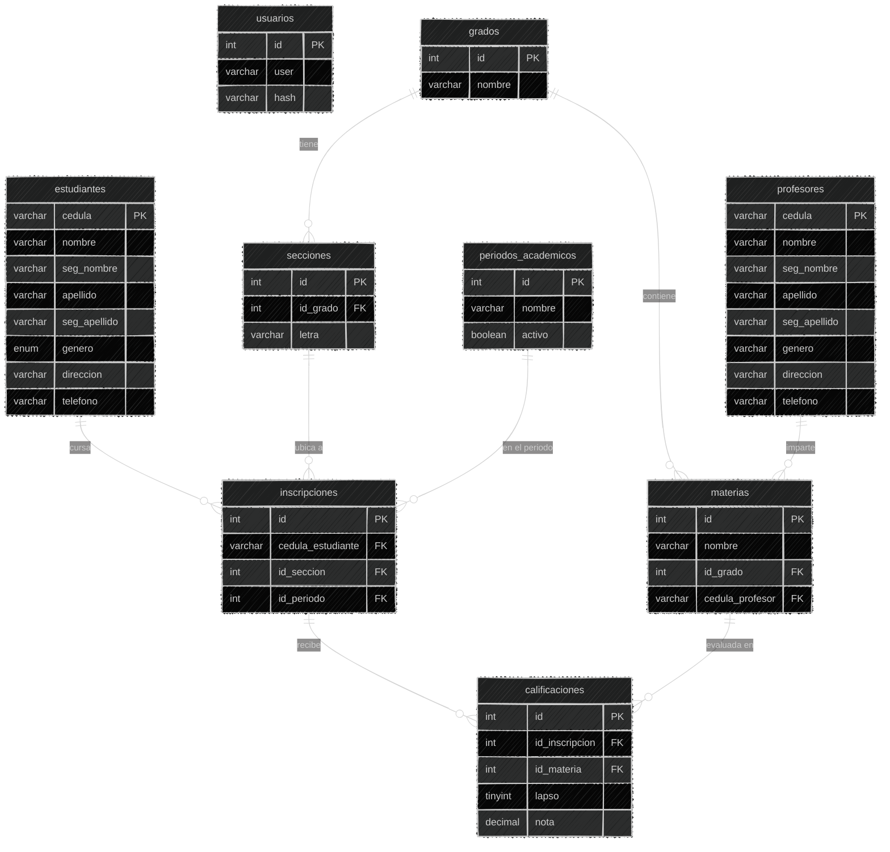

# Esquema de la Base de Datos

## Relaciones

1. Grados y Secciones (1 a N): Un grado (ej: 1er Año) agrupa varias secciones (A, B, C).

2. Grados y Materias (1 a N): Las materias pertenecen a un grado específico del plan de estudio (ej: Matemática de 1er Año).

3. Profesores y Materias (1 a N, opcional): Un profesor puede tener asignada una o varias materias. Si no tiene profesor asignado todavía, el campo cedula_profesor admite NULL.

4. Inscripciones (Entidad Puente central): Conecta al estudiante, su sección (y por ende su grado) y el periodo académico vigente (ej: 2025-2026). Posee una restricción única (cedula_estudiante, id_periodo) para evitar que un alumno se inscriba dos veces en el mismo año escolar.

5. Calificaciones (1 a N desde inscripciones y materias): Cada fila representa una evaluación individual identificada por su lapso (1, 2, 3 o 4) y su nota. Permite que el sistema sea escalable: las notas no están fijas como columnas (nota1, nota2), sino como registros individuales por materia y lapso.

6. Usuarios: Tabla independiente utilizada para el inicio de sesión y autenticación con contraseña encriptada (bcrypt) y token JWT.
