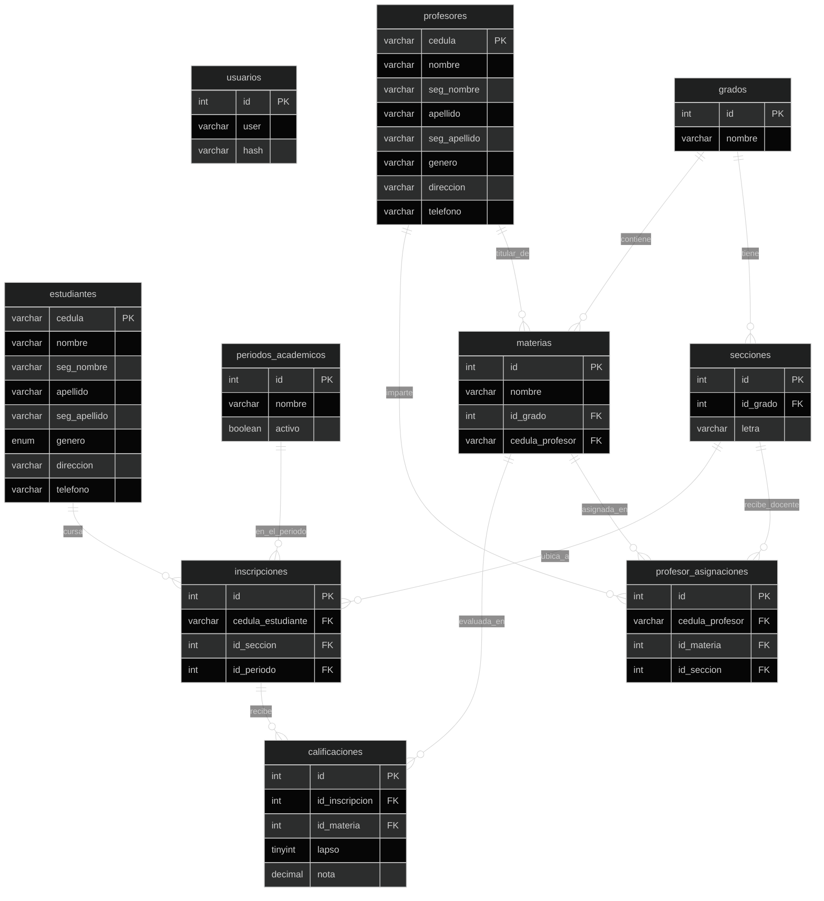

# Esquema de la Base de Datos

## Relaciones

1. **Grados y Secciones (1 a N):** Un grado (ej: 1er Año) agrupa varias secciones (A, B, C).
2. **Grados y Materias (1 a N):** Las materias pertenecen a un grado específico del plan de estudio (ej: Matemática de 1er Año).
3. **Profesores y Materias (1 a N, opcional):** Un profesor puede ser titular referencial de materias. Si no tiene profesor asignado todavía, el campo `cedula_profesor` admite `NULL`.
4. **Asignaciones de Profesores (`profesor_asignaciones` - Entidad Puente Ternaria):** Modela la relación N a M entre profesores, materias y secciones específicas (ej: el Prof. Pérez dicta *Matemática* en la sección *1er Año "A"*). Permite que distintas secciones tengan distintos profesores para la misma asignatura.
5. **Inscripciones (`inscripciones` - Entidad Puente Central):** Conecta al estudiante, su sección (y por ende su grado) y el período académico vigente (ej: 2025-2026). Posee la restricción única `UNIQUE KEY (cedula_estudiante, id_periodo)` para evitar que un alumno se inscriba dos veces en el mismo año escolar.
6. **Calificaciones (`calificaciones` - 1 a N):** Cada fila representa una evaluación individual identificada por su lapso (1, 2, 3 o 4) y su nota (escala 0.00 a 20.00). Permite atomicidad y escalabilidad sin columnas estáticas, vinculando la inscripción y la materia cursada.
7. **Usuarios (`usuarios`):** Tabla independiente utilizada para el inicio de sesión y autenticación con contraseña encriptada (`bcrypt`) y token de sesión (`JWT`).
